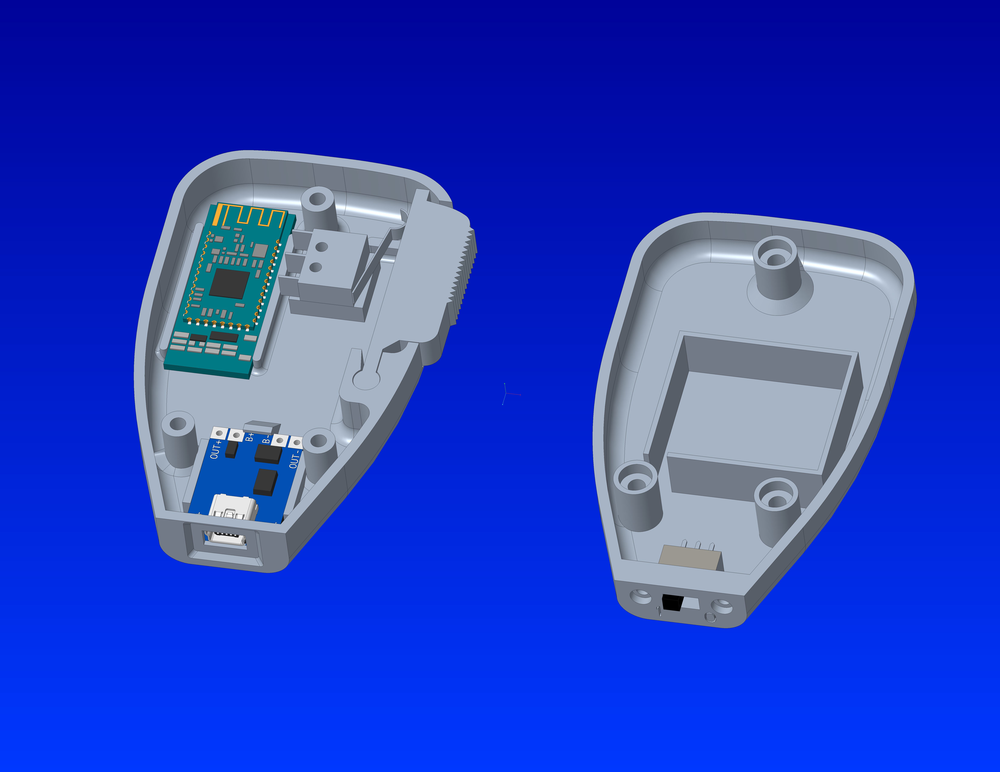

# ESP32 CW-ID Generator + Bluetooth Remote PTT

By **ON4NDO**.



Firmware for a classic ESP32 that does two things:

1. **Remote PTT** – a wireless push-to-talk button, built from a pair of
   HM-10 Bluetooth LE modules, keys your transmitter through a relay.
2. **CW-ID** – every time you key up, the ESP32 starts sending your callsign
   in Morse code as an audio tone (from the built-in DAC) after a delay you
   set on the web interface, and by default holds PTT until the ID is
   finished.

Everything is configured from a built-in web page: no app. Also optionally
publishes/controllable over MQTT - see
[MQTT / Home Assistant](#mqtt--home-assistant).

## Features

- Wireless PTT via two HM-10 BLE modules, plus a PTT button on the web page.
- Automatic CW-ID on key-up, after a configurable delay (0–50 s).
- If PTT is held continuously, the ID is repeated automatically every 5 minutes.
- Adjustable callsign, speed (5–30 WPM), tone (400–1500 Hz), volume and
  attack/release envelope (no key clicks).
- Test buttons for the full ID and for a plain tone.
- Settings are stored in flash and survive a reboot.
- Status LEDs for PTT and for the Bluetooth link.
- MQTT: publishes PTT/link/CW-ID state and every CW-ID setting, and lets you
  control all of it back (including PTT itself) - with Home Assistant MQTT
  Discovery, so it shows up as a device with ready-made entities. See
  [MQTT / Home Assistant](#mqtt--home-assistant).

## Hardware

> **Note:** the ESP32 itself has Bluetooth built in. This project uses two
> separate HM-10 modules anyway, because their simple point-to-point link
> (one paired as central, one as peripheral) does the whole wireless PTT
> connection with plain AT commands - no custom BLE/GATT code needed on the
> ESP32 side. It also means the handheld remote itself needs no
> microcontroller at all: the HM-10 there reads the button pin directly and
> reports its state over the link, so the remote is just the HM-10, the
> button and a battery.

| Part | Notes |
|---|---|
| Classic ESP32 dev board (WROOM/WROVER) | **Must be a classic ESP32**: the S2, S3, C3 and C6 have no DAC. |
| 2× HM-10 BLE module | Must be **genuine HM-10 (HMSoft firmware)**, see [HM-10 configuration](#hm-10-configuration). |
| Push button + 10 kΩ resistor | For the remote. |
| NPN transistor + relay (or optocoupler) | Switches the transmitter's PTT line. |
| 1–10 µF capacitor + resistor divider (e.g. 10 kΩ / 1 kΩ) | Brings the DAC audio down to microphone level. |

**Enclosure**: STEP files for a 3D-printable remote housing (top, bottom,
PTT knob) and the component models used to design it are in
[`3Dmodels/`](3Dmodels/).

### Wiring

| ESP32 pin | Connect to |
|---|---|
| GPIO16 (RX2) | HM-10 **TX** (base station module) |
| GPIO17 (TX2) | HM-10 **RX** (base station module) |
| GPIO21 | PTT output → transistor → relay → transmitter PTT |
| GPIO25 | CW audio (DAC) → capacitor → divider → transmitter mic input |
| GPIO2 | Status LED: on while PTT is active (most boards have this LED on board) |
| GPIO18 | LED: on while the remote is connected |
| GPIO19 | LED: blinks while the remote is disconnected |
| GPIO4 | Optional: goes high during each Morse dot/dash of the ID (keying output) |

Power the HM-10 modules from 3.3 V. Their logic is 3.3 V, so they connect
directly to the ESP32.

**Audio:** GPIO25 idles at about 1.65 V and swings up to 3.3 Vpp. Always
use a series capacitor to block the DC, and a voltage divider to reduce the
level to what your mic input expects. To keep your voice and the CW-ID from
mixing, you can switch the mic input over to the DAC during the ID with a
small relay or analogue switch.

**PTT polarity:** the PTT output is active-high by default. For an
active-low output, set `PTT_ACTIVE_HIGH` to `false` in the sketch.

## HM-10 configuration

The system uses two HM-10 modules:

- **Remote module**: battery powered, with the PTT button on its **PIO3** pin.
- **Base module**: wired to the ESP32.

The base module connects to the remote module automatically. The ESP32 then
keeps asking for the state of the button with `AT+PIO3?`, and the remote
module answers `OK+PIO3:0` (released) or `OK+PIO3:1` (pressed).

### What you need

- A 3.3 V USB-to-serial adapter (FTDI, CP2102, CH340…).
- A serial terminal at **9600 baud**. The Arduino IDE Serial Monitor works;
  set the line ending to **"No line ending"**. Genuine HM-10 modules expect
  commands without CR/LF.

Connect adapter TX → HM-10 RX, adapter RX → HM-10 TX, GND → GND, and
3.3 V → VCC. Configure one module at a time. The module must **not** be
connected to another Bluetooth device while you configure it.

### 1. Check that the module is a genuine HM-10

```
AT          → OK
AT+VERR?    → HMSoft V7xx (or similar)
```

If the version does not start with `HMSoft`, or `AT` gets no answer without a
line ending, the module is probably a clone (CC41-A, MLT-BT05, JDY-08…).
Clones usually do not support the remote pin mode used here, so replace them
with genuine modules. Flashing HMSoft firmware onto a CC2541 clone is
possible, but outside the scope of this guide.

### 2. Configure the remote module (the one with the button)

```
AT+RENEW      → factory defaults (optional, but a good starting point)
AT+ROLE0      → peripheral (slave)
AT+MODE1      → lets the connected device read its PIO pins
AT+ADDR?      → write down the 12-character address, e.g. OK+ADDR:20C38FF61234
AT+RESET
```

Wire the button between **PIO3** and **3.3 V**, and add a **10 kΩ pull-down**
from PIO3 to GND. The ESP32 treats `1` (high) as "PTT pressed", so the pin
must read low when the button is released.

### 3. Configure the base module (the one wired to the ESP32)

```
AT+RENEW                 → factory defaults (optional)
AT+ROLE1                 → central (master)
AT+NOTI1                 → report OK+CONN / OK+LOST (the ESP32 also sends this at boot)
AT+IMME1                 → wait for commands at power-up (needed to pair manually)
AT+CON20C38FF61234       → connect to the remote's address from step 2
```

When you see `OK+CONN`, the link works. Now make the connection automatic:

```
AT+IMME0                 → at power-up, reconnect automatically to the last device
AT+RESET
```

From now on the base module reconnects to the remote every time it powers
up. While connected, you can test the button from the terminal: `AT+PIO3?`
should answer `OK+PIO3:0` and `OK+PIO3:1` as you release and press it.

Both modules must stay at the default **9600 baud** (`AT+BAUD0`).

> Note: command details differ slightly between HMSoft firmware versions. If
> a command is rejected, check the datasheet for your firmware version.

## Installing the firmware

1. Install the Arduino IDE and the **esp32** board package by Espressif
   (Boards Manager).
2. The Arduino IDE requires the folder name to match the sketch name. Put all
   `.ino`, `.cpp` and `.h` files from this repository in a folder named
   **`esp32_callgever_ptt`**.
3. Install one extra library via **Tools → Manage Libraries...**: search for
   **PubSubClient** (by Nick O'Leary) and install it - needed for MQTT.
   Everything else (WiFi, WebServer, Preferences, ESPmDNS) is already
   included in the esp32 board package.
4. Open `esp32_callgever_ptt.ino`, select **ESP32 Dev Module** (or your
   board) and upload.
5. Open the Serial Monitor at 115200 baud to watch the log.

## First start

1. With no Wi-Fi saved, the ESP32 starts its own access point,
   **`ESP32-BT-PTT-Setup`**. Connect to it (on a phone, use Safari if on
   iOS) and open `http://192.168.4.1/`.
2. Enter your Wi-Fi network name and password. The ESP32 restarts and joins
   your network. If several access points broadcast the same network name,
   it scans first and connects to whichever one currently has the
   strongest signal. If it cannot connect within 15 seconds, it goes back
   to the setup access point.
3. Open **`http://esp32-BT-PTT.local/`**, or the IP address shown in the
   Serial Monitor.
4. Go to **CW-ID settings** and **set your own callsign** (the default is
   `ON4TEST`).

## Web interface

| Page | Purpose |
|---|---|
| `/` | Status of PTT, the Bluetooth link and the CW-ID, plus a hold-to-talk PTT button and the WiFi signal strength |
| `/callgever` | CW-ID settings, test ID and test tone |
| `/setup` | MQTT broker settings - see [MQTT / Home Assistant](#mqtt--home-assistant) |

### CW-ID settings

| Setting | Range | Default |
|---|---|---|
| Callsign | up to 15 characters | `ON4TEST` |
| Enabled | on / off | on |
| Volume | 0–100 % | 70 % |
| Speed | 5–30 WPM | 15 WPM |
| Tone | 400–1500 Hz | 800 Hz |
| Delay after key-up | 0–50 s | 25 s |
| Attack | 1–20 ms | 1 ms |
| Release | 1–50 ms | 10 ms |
| Releasing PTT aborts the ID | on / off | off |

At higher speeds a dot can be shorter than the release time (at 20 WPM a dot
is 60 ms). The tone then never fully fades between elements, so choose
release time and speed together.

## How the CW-ID behaves

- The ID starts when PTT goes from **off to on**, from the remote or the web
  button, and the configured delay has passed. If PTT is already on at boot,
  no ID is triggered.
- If you release PTT before the delay has passed, the ID is cancelled.
- Once the ID has started, it is always completed: PTT stays keyed until the
  ID ends, followed by 500 ms of silence. The exception is when **"Releasing
  PTT aborts the ID"** is on; then releasing PTT stops the ID immediately.
- Turning the CW-ID off on the web page stops a running ID immediately.
- If PTT stays held after the ID, a new ID needs a new key-up. The exception
  is a continuous transmission: if PTT is held without release, the ID is
  repeated at 4:59 and then every 5 minutes.
- **"Test ID"** really keys the transmitter. Make sure that is what you want
  when a radio is connected.

## MQTT / Home Assistant

Configure a broker on the `/setup` page (host, port, optional username/
password) and the ESP32 publishes its full state and lets you control it
back over MQTT - PTT, every CW-ID setting, and read-only status (link,
RSSI, uptime, SSID). It only connects in station mode (not during AP
setup), reconnects automatically if the broker drops, and forces PTT off
if the MQTT connection itself is lost while PTT was on via MQTT.

**Home Assistant**: if you use Home Assistant with its MQTT integration
already set up, this device appears automatically (MQTT Discovery) as one
device with a PTT switch, CW-ID switches (enabled / abort-on-release), a
callsign text field, number sliders for volume/speed/tone/delay/attack/
release, and sensors for the link, CW-ID-transmitting, RSSI, uptime and
SSID - no YAML needed.

**Topics** (base `esp32-bt-ptt/`, broker-relative):

| Topic | Direction | Payload |
|---|---|---|
| `esp32-bt-ptt/availability` | published, retained | `online` / `offline` (last-will) |
| `esp32-bt-ptt/state` | published, retained | one JSON object with everything (`ptt`, `link`, `cg`, `rssi`, `uptime`, `ssid`, `cg_enabled`, `cg_callsign`, `cg_volume`, `cg_wpm`, `cg_freq`, `cg_delay`, `cg_attack`, `cg_release`, `cg_abortrel`) |
| `esp32-bt-ptt/ptt/set` | subscribed | `ON` / `OFF` |
| `esp32-bt-ptt/cg_enabled/set` | subscribed | `ON` / `OFF` |
| `esp32-bt-ptt/cg_abortrel/set` | subscribed | `ON` / `OFF` |
| `esp32-bt-ptt/cg_callsign/set` | subscribed | plain text (trimmed, uppercased) |
| `esp32-bt-ptt/cg_volume/set` | subscribed | `0`–`100` |
| `esp32-bt-ptt/cg_wpm/set` | subscribed | `5`–`30` |
| `esp32-bt-ptt/cg_freq/set` | subscribed | `400`–`1500` |
| `esp32-bt-ptt/cg_delay/set` | subscribed | `0`–`50` (seconds) |
| `esp32-bt-ptt/cg_attack/set` | subscribed | `1`–`20` (ms) |
| `esp32-bt-ptt/cg_release/set` | subscribed | `1`–`50` (ms) |

Settings changed via MQTT are validated/clamped exactly like the web form
and saved to flash the same way. **WiFi and MQTT passwords are never
published.** There's no MQTT authentication/TLS beyond username+password -
treat the broker the same as the web page (see Limitations below).

## Limitations

- **No authentication**: anyone on your network (or on the setup access
  point, or your MQTT broker) can change settings and key the transmitter.
- The remote button is polled over the Bluetooth link, so a very short press
  (shorter than one poll round trip, typically a few tens of milliseconds)
  could be missed.
- Tested and in daily use on real hardware (ESP32 + HM-10 + a UniFi home
  network). Please open an issue if you run into problems when compiling or
  using it.

## TODO

- **Document the TP4056 low-current charging mod**: the TP4056 module used
  in the remote (see `3Dmodels/tp4056.stp`) ships configured for 1 A
  charging by default, which is far too much for the Li-Po cell(s) used
  here. Add a section explaining how to modify the module (resistor swap)
  for a safe, lower charge current.
- **Specify the battery/batteries used** in the remote (type, capacity,
  cell count) - not documented yet.
- **Document a UV-curing-glue lightpipe** for the charge LEDs: explain how
  to make a lightpipe with UV-curing glue so the TP4056 charge LEDs stay
  visible from outside the handheld enclosure.
- **Add a wiring diagram** - the wiring table is there, but a proper
  schematic would make assembly a lot easier to follow.

## License

[MIT](LICENSE): free to use, modify and share.
